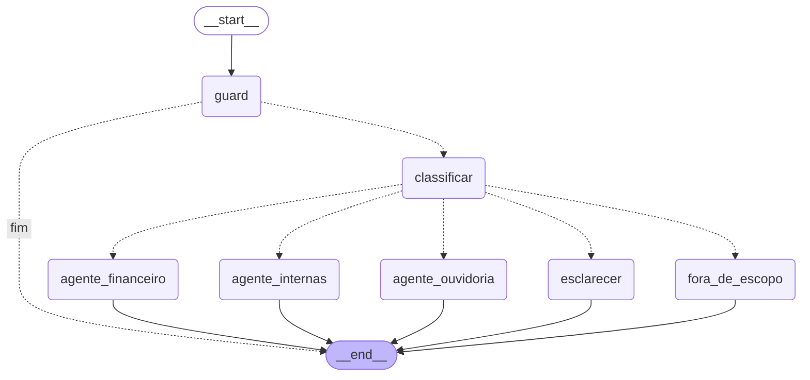

# Arquitetura

## Visão geral

```
navegador ──► FastAPI (app/main.py) ──► grafo LangGraph (app/orchestrator.py)
                │  trace_id por requisição       │
                │  log JSON por requisição       ├─ guard: validação e recusas determinísticas (app/guards.py)
                │                                ├─ classificar: Gemini ou regras (app/llm/)
                ▼                                ├─ agente_ouvidoria  ─► consultas fixas ─► PostgreSQL (papel ro)
         frontend estático                       ├─ agente_financeiro ─► consultas fixas ─► PostgreSQL (papel ro)
         (frontend/)                             ├─ agente_internas   ─► índice BM25 (documentos e FAQ, em memória)
                                                 ├─ esclarecer / fora_de_escopo
```

Um único serviço Python (FastAPI) com frontend estático, mais o PostgreSQL. Tudo sobe com
`docker compose up --build`. O LLM (Google Gemini, `gemini-3.1-flash-lite`) é usado em três pontos e
nunca produz números, SQL ou fontes:

| Ponto | O que o modelo faz | O que o código garante |
|---|---|---|
| Classificação | domínio + confiança + candidatos | saída validada por contrato; inválida → esclarecimento; confiança < 0,6 → esclarecimento |
| Parâmetros | JSON com período, filtros e tipo de consulta | campo inválido vira ausente; consulta escolhida de um catálogo fixo; valores sempre por parâmetro SQL |
| Redação (só informações internas) | texto curto a partir dos trechos | fontes escritas pelo código; número que não está nos trechos descarta a redação; proibição do documento é mantida |

Sem `GEMINI_API_KEY`, ou quando o provedor falha numa requisição, as mesmas etapas são feitas por regras
(`app/llm/rules.py`) e pela resposta extrativa; a resposta sai com `modo: "degradado"`.

## Grafo de orquestração

Gerado com `montar_grafo(...).get_graph().draw_mermaid()`:



- **guard**: pedido de credencial, dados de terceiros ou padrão de prompt injection → recusa, sem chamar o LLM.
- **classificar → agente**: domínio com confiança ≥ 0,6. `ambigua` ou confiança baixa → **esclarecer**
  (pergunta multi-domínio pede ao usuário o domínio, sem combinar agentes). `fora_de_escopo` → explica os três domínios.
- LangGraph só roteia: não há tool-calling livre; o LLM não escolhe ferramentas.

## Fluxo de dados

1. **Ingestão** (`app/ingestion.py`, na subida): aplica `data/sql/schema.sql`, carrega os 3 CSV
   (300 lançamentos, 144 orçamentos, 180 manifestações) com validação de datas e enums e valores em
   `NUMERIC`; upsert idempotente. `data/` é montado somente leitura.
2. **Índice** (`app/rag/index.py`, na subida): 10 documentos + 7 perguntas do FAQ, BM25 próprio sobre
   termos normalizados; item com padrão de injeção não é indexado.
3. **Pergunta** (`POST /ask`): grafo → agente → resposta montada por código (`app/agents/`), com
   `fontes` `{tipo, ref, detalhe}` (arquivo, protocolo, lançamento ou consulta).

## Papéis de banco

| Papel | Uso | Permissões |
|---|---|---|
| `POSTGRES_USER` (dono) | ingestão e DDL, só na subida | todas no banco da aplicação |
| `aurora_ro` (`DB_RO_USER`) | toda consulta da API | `CONNECT`, `USAGE` no schema, `SELECT` nas 3 tabelas |

As consultas são pré-definidas em `app/queries/` e parametrizadas; nomes de coluna vêm de listas fixas.
Mesmo que o modelo fosse manipulado, a API só consegue ler.

## Rastreabilidade e logs

- Cada requisição recebe um `trace_id` (UUID), devolvido no corpo e no cabeçalho `X-Trace-Id`, e exibido no frontend.
- Um registro JSON por requisição em `logs/interactions.jsonl` (volume `app_logs`) e no stdout:
  `timestamp`, `trace_id`, `pergunta`, `dominio_previsto`, `confianca`, `agente`, `fontes`,
  `latencia_ms`, `status`, `modo`, `erro`.
- Consultar:
  ```bash
  curl -s localhost:8000/traces/<trace_id>                 # um registro
  docker compose exec app tail -n 20 logs/interactions.jsonl
  docker compose logs app | grep "falha do provedor"       # quedas para as regras
  ```
- **Política de dados nos logs**: sem chaves, tokens ou senhas; erros entram resumidos (tipo e
  mensagem curta). A pergunta é gravada como digitada (exigência de rastreabilidade); se o usuário
  digitar dado pessoal, ele vai para o log (ver `docs/limitacoes.md`). Os dados da base são sintéticos.

## Testes e avaliação

- `pytest` (241 testes): lógica com `FakeLLM`, sem rede; financeiro conferido por cálculo independente
  sobre os CSV (`tests/oracle.py`).
- `scripts/evaluate.py`: os 12 casos AV-T001–AV-T012 contra a API com o LLM real, checagens
  determinísticas, juiz complementar (`scripts/judge.py`) e log em `docs/evaluation/`.
- CI (`.github/workflows/ci.yml`): lint, `pytest` e `docker compose up` com perguntas de fumaça, sem chave.
